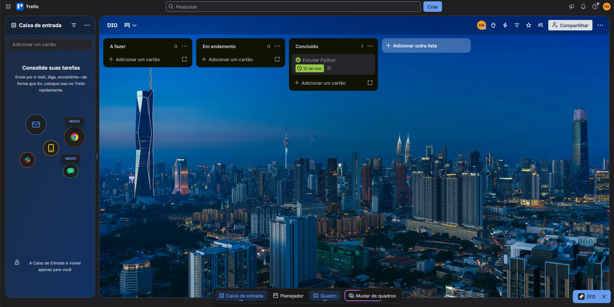

# Agente de IA para Organizar Tarefas no Trello — DIO

Agente em **Python** criado para o desafio da Digital Innovation One (DIO), com **Google Agent Development Kit (ADK)**, **Gemini** e **py-trello**. O agente recebe pedidos em português, cria um cartão por tarefa, consulta o andamento do trabalho e move cartões entre as listas do Trello.

**Quadro do projeto:** [DIO no Trello](https://trello.com/b/UyHzDLmR/dio) — as listas `A fazer`, `Em andamento` e `Concluído` foram criadas. O quadro não precisa ser público; cada pessoa executa o agente com suas credenciais.

## Funcionalidades

| Ferramenta Python | Funcionalidade |
|---|---|
| `obter_data_atual()` | Retorna a data no fuso horário configurado. |
| `criar_tarefa(nome, descricao, data, status)` | Cria cartão com título, descrição, vencimento e status inicial. Se a data for omitida, usa hoje. |
| `listar_tarefas(status)` | Lista todos os cartões abertos ou somente os de um status. |
| `mudar_status_tarefa(nome, novo_status)` | Move cartão para uma das três listas, por nome exato ou ID. |

O ADK registra essas funções como ferramentas do Gemini em `agente_tarefas/agent.py`. A instrução informa a data atual e orienta o agente a perguntar pelas tarefas quando a conversa começar.

## Estrutura

```text
agente-tarefas-trello-dio/
├── agente_tarefas/
│   ├── __init__.py
│   ├── agent.py
│   ├── config.py
│   └── trello_tools.py
├── tests/
│   ├── conftest.py
│   └── test_tools.py
├── evidencias/
│   └── README.md
├── .env.exemplo
├── configurar.ps1
├── iniciar.ps1
├── TESTES.md
├── .gitignore
├── requirements.txt
├── requirements-dev.txt
└── README.md
```

## Configuração no Windows (PowerShell)

É necessário **Python 3.10+**, conta no [Trello](https://trello.com/) e chave de API do [Google AI Studio](https://aistudio.google.com/apikey).

```powershell
powershell -ExecutionPolicy Bypass -File .\configurar.ps1
```

O script cria `.venv`, instala as dependências, copia `.env.exemplo` para `.env` (se ainda não existir), abre o Bloco de Notas para inserir suas chaves e executa os testes locais. Para configuração manual, use `py -3 -m venv .venv`, instale com `pip install -r requirements-dev.txt` e copie `.env.exemplo` para `.env`.

Edite o `.env` **somente no seu computador**, preenchendo:

- `GOOGLE_API_KEY`: chave pessoal do Gemini (Google AI Studio).
- `TRELLO_API_KEY`: chave da API do Trello.
- `TRELLO_API_TOKEN`: token Trello com permissões de leitura e escrita.
- `TRELLO_BOARD_NAME=DIO`: nome do quadro; se houver duplicatas, informe `TRELLO_BOARD_ID`.
- `APP_TIMEZONE=America/Campo_Grande`: ajuste conforme sua localização.
- `GEMINI_MODEL=gemini-3.5-flash-lite`: modelo com suporte a ferramentas, configurável conforme disponibilidade (consulte o AI Studio).

As chaves do Trello são obtidas no [portal de Power-Ups](https://trello.com/power-ups/admin/). Veja o [guia fornecido na aula da DIO](https://github.com/digitalinnovationone/agent-carbon-footprint/blob/main/agents/agent04/readme.md). Crie um aplicativo, obtenha a API key e autorize um token de acesso (escopos `read` e `write`). **Não use o token da conexão ChatGPT/Trello no `.env`**: ela é uma integração distinta e não fornece credenciais para o programa Python.

A biblioteca oficial do ADK recomenda executar `adk web` **a partir da pasta pai** do pacote de agente. A partir da raiz deste repositório:

```powershell
powershell -ExecutionPolicy Bypass -File .\iniciar.ps1
```

Alternativamente, use `.\.venv\Scripts\adk.exe web --port 8000`.

Abra <http://localhost:8000>, selecione `agente_tarefas` e inicie com **"Olá"**. A interface é para testes locais; não a exponha publicamente.

## Testes

Os testes de unidade usam objetos simulados para não precisar de credenciais reais nem modificar o Trello:

```powershell
.\.venv\Scripts\python.exe -m pip install -r requirements-dev.txt
.\.venv\Scripts\python.exe -m pytest -q
```

**Resultado local:** **9 testes passaram**, conforme [TESTES.md](TESTES.md). Os testes são simulados.

**Cenários cobertos:** criação de cartões, listagem, mudança de status, palavras com/sem acento, nomes duplicados, datas e erros de conexão sem exposição de credenciais.

## Testes reais — integração com Gemini e Trello

Em **12 de novembro de 2026**, a integração foi **executada e comprovada por capturas de tela** do ADK Web e do quadro real DIO. O comando do agente foi interpretado pelo Gemini, que chamou as funções Python `listar_tarefas`, `criar_tarefa` e `mudar_status_tarefa`.

| Etapa | Evidência no ADK | Evidência no Trello |
|---|---|---|
| Listar tarefas (quadro vazio) | [Listagem inicial](evidencias/01-listagem-vazia-adk.png) | — |
| Criar **Estudar Python** com descrição e vencimento de 12/11/2026 | [Chamada `criar_tarefa`](evidencias/02-criacao-adk.png) | [Cartão em **A fazer**](evidencias/03-cartao-a-fazer-trello.png) |
| Mover para **Em andamento** | [Chamada `mudar_status_tarefa`](evidencias/04-movimentacao-adk.png) | [Cartão em **Em andamento**](evidencias/05-cartao-em-andamento-trello.png) |
| Mover para **Concluído** e listar novamente | [Movimentação + listagem](evidencias/06-conclusao-e-listagem-adk.png) | [Cartão em **Concluído**](evidencias/07-cartao-concluido-trello.png) |



Confira todas as imagens em [evidencias/](evidencias/README.md). As capturas demonstram a execução real, enquanto os **9 testes de unidade** validam funções isoladamente.

## Melhorias implementadas sobre o exemplo-base

1. **Status flexíveis:** entende `concluído`, `concluido`, `feito`, `em andamento`, `fazendo`, `pendente` e outras variações.
2. **Data consistente:** converte a data local em um instante UTC equivalente a **12h locais**, reduzindo erros de exibição de um dia por diferença de fuso. O fuso é configurável.
3. **Reutilização de conexão:** a criação do cliente e a seleção do quadro ficam centralizadas, sem código repetido.
4. **Erros controlados:** nomes duplicados exigem ID; o agente só diz que uma ação deu certo quando a ferramenta confirma. Erros HTTP não devolvem segredos ao chat.
5. **Segurança:** `.gitignore` impede o versionamento do `.env`, caches e bancos locais. `.env.exemplo` contém apenas valores fictícios.

## Estado da entrega

- [x] Quadro DIO com as três listas criado.
- [x] Código do agente e ferramentas Python preparados.
- [x] Arquivos `requirements.txt`, `.env.exemplo`, `.gitignore` e testes incluídos.
- [x] Testes de unidade automatizados criados e executados: 9 passaram.
- [x] Execução **real** do `adk web` com chaves pessoais de Gemini e Trello (12/11/2026).
- [x] Prints reais da conversa e do quadro adicionados em `evidencias/`.
- [x] Repositório público criado: https://github.com/UnigranAlunasso/agente-tarefas-trello-dio
- [ ] Link do repositório enviado à DIO.

**Observação:** as evidências registram os testes reais realizados pelo autor no Google ADK Web e no quadro Trello. Nunca inclua `.env`, chaves, tokens ou dados sensíveis no GitHub.

## Referências

- [Desafio base DIO — `agents/agent04`](https://github.com/digitalinnovationone/agent-carbon-footprint/tree/main/agents/agent04)
- [Google ADK — Python Quickstart](https://github.com/google/adk-docs/blob/main/docs/get-started/python.md)
- [py-trello — biblioteca Python](https://github.com/sarumont/py-trello)
- [Guia Trello da DIO](https://github.com/digitalinnovationone/agent-carbon-footprint/blob/main/agents/agent04/readme.md)
